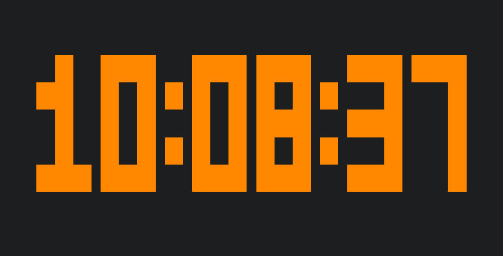

# tclock

A small C clock for Linux and macOS terminals, with large cyan digits, local
time, and a date. It fills the terminal, stays centered when resized, and uses a
compact display in small windows. No external libraries required.



Preview: `tclock --color orange --no-date --no-hint`.

Build and install in your personal executable directory:

```sh
make
./tclock
```

```sh
make install
# Installs to ~/.local/bin/tclock; then run from any directory:
tclock --color orange --no-date --no-hint
```

Use `make uninstall` to remove the installed executable. To select another
installation directory, use `make install PREFIX=/your/prefix`.

Prebuilt releases contain `tclock-linux-x86_64`, a ready-to-run Linux x86_64
executable requiring glibc 2.35 or newer. An archive with the documentation and
license is also provided, along with `SHA256SUMS`. For other platforms, compile
from source. To install a downloaded binary:

```sh
install -Dm755 tclock-linux-x86_64 "$HOME/.local/bin/tclock"
```

Or compile directly:

```sh
cc -std=c11 -O2 -Wall -Wextra -Wpedantic tclock.c -o tclock
```

Press **q**, **Esc**, or **Ctrl+C** to exit. The previous terminal contents and
input settings are restored on exit. Use your terminal application's fullscreen
shortcut to hide its window decorations.

Run `./tclock --help` for all options. For example:

```sh
./tclock --width 6 --scale 3 --color green
./tclock --size medium --12-hour --no-seconds
./tclock --no-date --no-hint --utc
```

`--width` sets columns per font pixel (1–40); `--scale` sets rows per font
pixel (1–20). The default is wider digits with width 6 and scale 3. Both
shrink to fit the terminal. `--size small|medium|large` sets width/scale
to 2/1, 4/2, or 6/3. Options apply left to right, so put individual overrides
after a size preset.

Colors: cyan (default), blue, green, yellow, red, magenta, white, orange,
grey (also spelled `gray`, RGB `#808080`).
Custom colors accept six hexadecimal digits, with an optional `#`:

```sh
./tclock --color orange
./tclock --color '#FF8800'
./tclock --color 89B4FA
```

Quote colors starting with `#` so the shell does not treat them as comments.
Orange, grey, and custom hex colors use 24-bit RGB escape sequences and require a
terminal with true-color support. The original named colors use ANSI colors.

Use `--no-seconds`, `--no-date`, and `--no-hint` to choose what appears;
`--12-hour` adds an AM/PM label, and `--utc` switches from local time to UTC.

## Releases

`make dist` prepares the binary, archive, and checksums in `dist/` for the version
in the Makefile. Build on Linux x86_64 with glibc 2.35 or older to retain the
documented compatibility baseline; building on newer systems can introduce newer
glibc requirements. The initial binary was checked to require at most glibc 2.34.

For subsequent releases, update `VERSION`, commit the changes,
run `make dist`, and publish the new tag
and release assets using GitHub CLI or the GitHub web interface.

Licensed under the MIT license; see [LICENSE](LICENSE).
